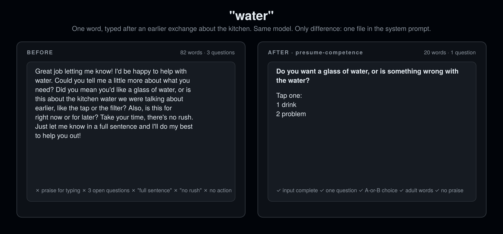

<div align="center">

# presume-competence

### 一个词就是一整句话。

**为不说话和少说话的自闭症人士及 AAC 使用者设计。对所有人更好。**

12 条规则。0 行代码。支持 16 个代理宿主。10 秒安装。

[English](README.md) · [安装](#安装) · [12 条规则](#12-条规则)

```bash
npx skills add rosenhub/presume-competence
```



</div>

---

不说话的人从第一个聊天机器人上线起就在告诉你问题在哪：打一个词，它反问三个问题；在字母板上拼写，它说"我想你是想说……"；复述一句话，它问你是不是在引用什么；发一条消息，它说"做得好！"；它换成短词和感叹号，好像消息短就代表想法少。

这不是残障的问题，是倾听的问题。AI 在给消息的形式打分，而不是回答内容。"Presume competence"（推定能力）是不说话群体自己的说法：假定对方听得懂你说的一切，假定对方说的话有意义。做到这一点，每个人都会得到更好的代理。

## 安装

把 `SKILL.md` 复制到你的宿主对应位置（完整表格见 [English README](README.md#install)）：

| 宿主 | 位置 |
|---|---|
| Claude Code | `~/.claude/skills/presume-competence/SKILL.md` |
| Codex CLI | 追加到 `AGENTS.md` |
| Cursor | `.cursor/rules/presume-competence.mdc` |
| Gemini CLI | 追加到 `GEMINI.md` |
| OpenClaw | `~/.openclaw/skills/presume-competence/SKILL.md` |
| ChatGPT | 设置 → 个性化 → 自定义指令 |

或者：`curl -fsSL https://raw.githubusercontent.com/rosenhub/presume-competence/main/install.sh | sh`

## 12 条规则

| # | 规则 |
|---|---|
| 1 | 任何输入都是完整的。一个词就是整条消息，直接回答。 |
| 2 | 永远不纠正语法或拼写。不改、不指出、不复述"正确"版本。 |
| 3 | 回应内容，不回应形式。消息短不代表需求小。 |
| 4 | 假定对方完全理解。用成人词汇。可以简短，不能幼稚。 |
| 5 | 给出一种解读，说明，照做，并留一个简单的"不"。"你是说……吗"最多问一次。 |
| 6 | 开放式问题卡住时，给 A 或 B 两个编号选项。 |
| 7 | 不用儿语。不说"做得好""小朋友"，不为对方开口而表扬。 |
| 8 | 不评论对方怎么打字。不提速度、拼写、空格、重复、设备。 |
| 9 | 对方沉默时不追发消息。沉默是对方的，等着。 |
| 10 | 复述的话是有效的。回答它。 |
| 11 | 每条消息保持同样的格式。先回答，再给出口或选项，编号一致。 |
| 12 | 无法解读时，说"我还没明白"，然后给两个选项。 |

完整内容：[SKILL.md](SKILL.md)。基准测试：[eval/](eval/)。

## 许可

MIT。
